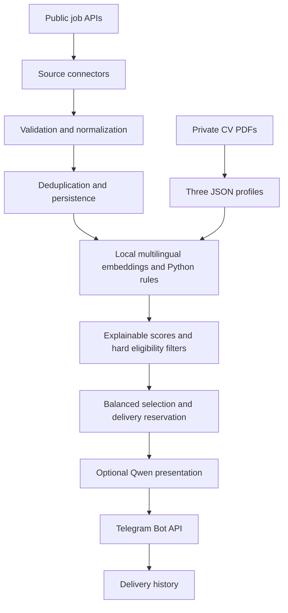

# AI Job Hunter

Explainable job discovery for three candidate orientations: **AI Engineering**,
**Data Science** and **Full Stack Development**. Built with Python, multilingual
Sentence Transformers, SQLAlchemy, PostgreSQL/SQLite and outbound Telegram messages.

**Version 0.2.** Working local matching and a prepared cloud execution path.
Real Telegram/Qwen delivery still needs the user's credentials; Render deployment
requires reconnecting the account. This repository does not claim a live service.

**[Guide en français](docs/setup-fr.md)** · [Matching design](docs/matching.md) ·
[Sources](docs/sources.md) · [Deployment](docs/deployment.md)

## What it does

- Collects public Arbeitnow and Jobicy postings with bounded requests and source isolation.
- Cleans HTML, validates normalized records, deduplicates source identities and retains provenance.
- Imports three private PDF CVs into separate configurable profiles, with contact lines removed.
- Computes multilingual embeddings locally, cosine similarity, skills coverage, seniority,
  education and geographic compatibility using independently testable Python algorithms.
- Ranks jobs across profiles, preserving score breakdowns, reasons and scoring revisions.
- Prepares one Telegram message per opportunity with a shared daily limit and durable history.
- Optionally asks Qwen to present the already calculated result; a Python summary is the fallback.

**An LLM never generates embeddings, decides eligibility, calculates scores or ranks jobs.**
Remote does not imply worldwide: unknown eligibility is excluded from automatic delivery.
The score measures configured relevance, not the probability of being hired.

## Architecture



Repositories isolate SQL access. Alembic owns schema migrations. A complete run is
a bounded CLI process, so a web server or permanent Telegram polling process is unnecessary.
SQLite runs locally without credentials; PostgreSQL retains history in hosted execution.

## Quick demo: no CV, token or network required

Requires Python 3.11 or later. From PowerShell in this directory:

```powershell
py -3.11 -m venv .venv
.\.venv\Scripts\python.exe -m pip install -e '.[dev]'
.\.venv\Scripts\python.exe -m app demo
.\.venv\Scripts\python.exe -m app evaluate --backend tfidf
```

The demo uses eight clearly synthetic postings, three anonymous example orientations,
SQLite and an explicitly labelled lexical TF-IDF baseline. It previews messages and
never sends them. It keeps demo data separate from the real local database.
On Linux/macOS, use `python3.11` and `.venv/bin/python` instead of the Windows paths.

## Run with the real CVs and multilingual model

```powershell
.\.venv\Scripts\python.exe -m pip install torch --index-url https://download.pytorch.org/whl/cpu
.\.venv\Scripts\python.exe -m pip install -e '.[dev,postgres,ml]'
# Copy .env.example to .env if .env does not exist yet.
.\.venv\Scripts\python.exe -m app import-cvs
.\.venv\Scripts\python.exe -m app init-db
.\.venv\Scripts\python.exe -m app run
.\.venv\Scripts\python.exe -m app match --include-blocked --limit 10
```

`profiles/resume_manifest.json` maps CV paths to orientations and target roles.
The import writes gitignored JSON profiles under `profiles/private/`. Review residence,
work authorization and experience assumptions before using automatic filtering.

The pinned multilingual model is
`sentence-transformers/paraphrase-multilingual-MiniLM-L12-v2`. Its model ID, revision,
batch size and CPU thread count are configurable. Token-window pooling handles long
text, and cached vectors avoid repeated inference. Initial downloads and cold CPU runs
can take several minutes. A failed model load does not silently switch to TF-IDF.

## Telegram and Qwen configuration

Fill these fields in the private `.env` file:

```dotenv
TELEGRAM_BOT_TOKEN=
TELEGRAM_CHAT_ID=
QWEN_API_KEY=
QWEN_BASE_URL=
QWEN_MODEL=qwen-plus
LLM_ENABLED=false
```

The Qwen base URL and model must match the user's provider, account and region.
Enable `LLM_ENABLED` after configuring them. No Telegram account API ID/API hash is
needed for outbound Bot API messages. Start a conversation with the bot first.

```powershell
.\.venv\Scripts\python.exe -m app doctor
.\.venv\Scripts\python.exe -m app notify
.\.venv\Scripts\python.exe -m app notify --send
# Full collection, matching and actual sending:
.\.venv\Scripts\python.exe -m app run --notify
```

`notify` previews by default. `doctor` checks database connectivity and configuration
presence; it does not verify API credentials. Qwen receives a small job excerpt and
calculated results, never the full CVs or candidate contact details.

## Configuration and data

| Setting | Default |
|---|---|
| Database | `sqlite:///data/job_hunter.db` |
| Profile input | `profiles/private/*.json`, then the public fallback profile |
| Embedding backend | Local Sentence Transformers |
| Score weights | Semantic 35%, skills 25%, experience 20%, education 10%, location 10% |
| Notification threshold | 65/100 |
| Daily opportunity cap | 10 across all profiles |
| Counter timezone | `Africa/Algiers` |
| Maximum job age | 45 days |
| Arbeitnow page budget | 1 |
| Jobicy page budget | 2, with an hourly synchronization cache |

See [.env.example](.env.example) for the complete configuration. Environment variables
override dotenv files. `--env-file .env.neon` before the command selects a separate
private PostgreSQL configuration. The weights and thresholds are initial hypotheses.

Eight tables preserve sources, companies, jobs, profiles, skills, matching snapshots,
per-profile notification history and shared delivery reservations. Source IDs are
unique; exact content copies point to a canonical row. Different application URLs
can remain separate. Missing jobs in a bounded feed are not automatically expired.

The notifier persists its reservation before touching Telegram. Ambiguous delivery
responses are quarantined instead of automatically retried. This avoids automatic
duplicates after a lost response, but is not an exactly-once delivery guarantee.

## Tests and evaluation

```powershell
.\.venv\Scripts\python.exe -m pytest --cov=app --cov-report=term-missing -q
.\.venv\Scripts\ruff.exe check app tests scripts alembic
.\.venv\Scripts\ruff.exe format --check app tests scripts alembic
.\.venv\Scripts\python.exe -m app evaluate
```

Offline tests use mocked HTTP and migrated temporary SQLite databases. An optional
PostgreSQL integration test runs against a disposable `_test` database when
`TEST_POSTGRES_URL` is supplied. CI includes PostgreSQL, a container build and a demo.

The initial 22 labelled pairs are **illustrative synthetic cases**, authored during
implementation. They exercise basic positive/negative decisions and are not evidence
of real-world recommendation quality. Human-reviewed real postings, a held-out test
set and top-k evaluation remain necessary before making performance claims.

`requirements-runtime.lock` pins the CPU runtime; `requirements-dev.lock.txt` records
the development environment. The CPU wheel index is included. `pyproject.toml`
defines the supported dependency ranges and optional `ml`, `postgres` and `dev` extras.

## Hosting

The Docker image preloads the pinned model and runs as a non-root user. `render.yaml`
defines a daily cron job; `.github/workflows/daily.yml` is an alternative scheduler
that stays inactive unless `SCHEDULER_BACKEND=github` is configured.

Use one scheduler. Hosted runs require PostgreSQL and private injected profiles.
`PIPELINE_ENABLED` and `NOTIFICATIONS_ENABLED` are initially false so an unconfigured
deployment does not execute against example profiles or lose history in ephemeral SQLite.
Export private profiles with `python -m app export-profiles`, then store the resulting
`private/profiles.json` as the hosting secret `PROFILES_JSON`.

See [the deployment guide](docs/deployment.md) for the remaining account setup,
secrets, scheduling, cost considerations and validation limits.

## Sources and current limits

Listings retain their original source and canonical application URL:
**[Arbeitnow](https://www.arbeitnow.com)** and **[Jobicy](https://jobicy.com)**.
Their public interfaces and terms were checked on 15 November 2026; see
[the source notes](docs/sources.md).

Coverage is not yet comprehensive for Algeria. Geography and skill rules are
conservative heuristics with a finite vocabulary; ambiguous cases need review.
Greenhouse, Lever, Algerian company career pages, richer evaluation and interactive
bot commands remain future extensions.

Private PDFs, extracted profiles, secrets, caches and real job data are excluded
from Git and Docker. This public repository contains only examples and source code.
