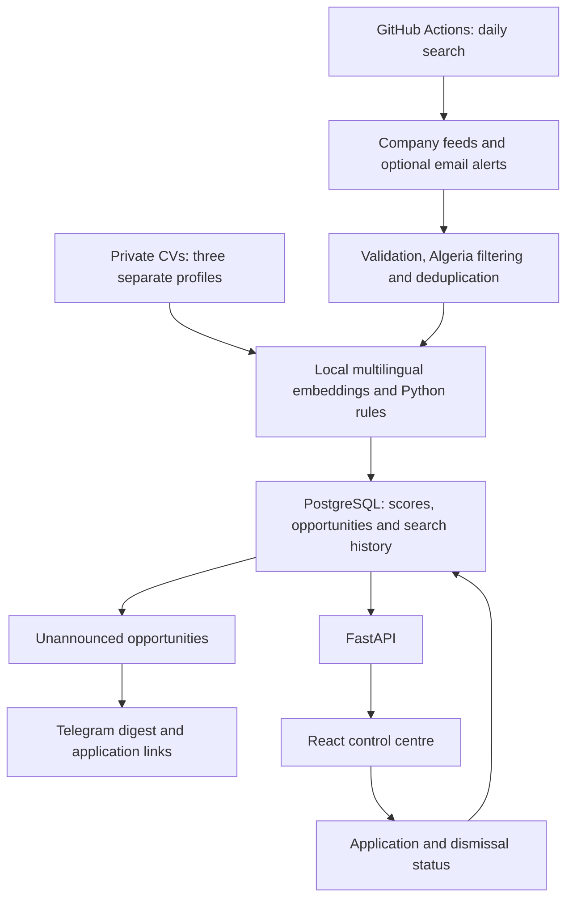

# Job Hunter

**Explainable job discovery and application tracking for the Algerian market.**

[](https://github.com/BachtarziMounderr/Job_hunter/actions/workflows/ci.yml)

Job Hunter turns company career listings into a personal, actionable shortlist.
It compares openings against separate **AI Engineering**, **Data Science** and
**Full Stack Development** CV profiles, explains each match, and keeps application
states in a **React + FastAPI** dashboard.

The daily pipeline runs on **GitHub Actions**, stores its history in **PostgreSQL
on Neon**, and sends a **Telegram digest containing only previously unannounced
opportunities**. The dashboard runs locally and shares the same database.

[Dashboard guide — FR](docs/dashboard-fr.md) · [Matching design](docs/matching.md) ·
[Source access](docs/sources.md) · [Cloud setup](docs/deploy-algeria.md)

## Results from a real execution

The **19 November 2026** validation run processed live company feeds and the three
configured CV orientations:

| Pipeline output | Observed result |
| --- | ---: |
| Listings collected | **72** |
| Relevant openings retained for matching | **9** |
| CV profiles compared | **3** |
| Job–profile comparisons | **27** |
| Opportunities requiring review | **6** |
| Recommendations passing every criterion without reservations | **0** |
| Previously announced opportunities sent again on the repeat run | **0** |

The six review candidates remained accessible in the dashboard. Their scores and
reservations help the user decide which original job descriptions to read before
applying. A high score can still require review when experience is unclear or a
listing is old.

### Companies and roles surfaced

| Company | Connected source | Examples found during validation |
| --- | --- | --- |
| **Yassir** | Public Lever job feed | Full Stack Engineer (Node.js & React); Marketing Data Analyst; Data Analyst (Financial Services); Frontend Engineer |
| **AYRADE** | Official recruitment pages | Intégrateur Odoo |

The same execution received **64 listings from Yassir** and **8 from AYRADE**;
respectively **7** and **2** entered the matching stage after role filtering.
These are dated observations; current listings change with the employers' feeds.
Source connectors are configured in [career_sources.json](config/career_sources.json).

The release also passed **153 automated tests** on GitHub, including PostgreSQL
integration, with successful React and Docker builds. Browser checks covered
application redirects, persistent status changes, undo, filters and mobile layouts.

Evidence: [validated CI run](https://github.com/BachtarziMounderr/Job_hunter/actions/runs/44524846988)
and [live pipeline run](https://github.com/BachtarziMounderr/Job_hunter/actions/runs/44524934303).

## Technical stack

| Layer | Technologies and responsibility |
| --- | --- |
| Interface | **React 19, Vite, JavaScript, responsive CSS** — search, profile filters, available offers and application history |
| API | **FastAPI, Pydantic, Uvicorn** — validated state transitions, server-side filtering and pagination |
| Matching | **Sentence Transformers, PyTorch CPU, NumPy, scikit-learn** — multilingual embeddings, cosine similarity and an explicit TF-IDF demo baseline |
| Persistence | **SQLAlchemy 2, PostgreSQL / Neon, SQLite, Alembic** — relational history, migrations and durable opportunity identities |
| Automation | **GitHub Actions, Docker** — scheduled collection, preloaded model, non-root runtime and CI checks |
| Delivery | **Telegram Bot API, HTTPX** — one digest, direct application links and delivery confirmation |
| Optional integrations | **Groq / Qwen** for presentation; **Gmail OAuth** for personal job-alert ingestion |

## Architecture



The scheduled process handles collection and inference independently of the web
server. FastAPI serves the dashboard and its API from the same origin; the open
interface refreshes every **30 seconds**. Daily searches continue while the user's
computer is off.

The cron expression is `0 11 * * *`: **12:00 Africa/Algiers**. GitHub can delay a
scheduled start, so completion notifications arrive after execution finishes.

## Engineering decisions

### Explainable multilingual matching

The encoder is the revision-pinned
`sentence-transformers/paraphrase-multilingual-MiniLM-L12-v2`. Long descriptions
are split into token windows; window embeddings are mean-pooled and normalized.
Vectors are cached by text hash and model version, with atomic writes after small
batches so interrupted runs can reuse completed work.

Python combines five independently inspectable components:

| Component | Default weight |
| --- | ---: |
| Semantic similarity | 35% |
| Skills compatibility | 25% |
| Experience | 20% |
| Education | 10% |
| Location | 10% |

Geography, role compatibility and excessive seniority remain separate eligibility
checks. A strong semantic similarity cannot override a blocking criterion.
Recommendations use a default **65/100** threshold; compatible but uncertain
candidates enter a separate **review** category from **50/100**.

Immutable matching snapshots retain profile and job content hashes, model identity,
weights and rule fingerprints. Groq or Qwen can summarize the calculated results;
eligibility, scores and rankings remain in Python. Full CVs and candidate contact
details are kept out of LLM presentation requests.

### Persistent identity and application state

The schema uses **11 relational tables** to separate source listings, profiles,
skills, matching snapshots, opportunities, searches and delivery history.

An opportunity is reconciled across searches using normalized company, title and
locality, with application-URL reconciliation when a title changes. Application
state survives new descriptions, refreshed scores and repeated collection.

In the dashboard, **Candidater** saves the status before opening the employer's
page. The offer moves to **Candidatures faites** and can be restored. This records
the user's click; the external application form is completed on the recruitment
site. Closed listings leave the available inbox after a complete source snapshot,
while application history is retained.

### Failure-aware automation

- Each source is collected independently, with bounded requests and retries for
  transient public-feed errors. A partial collection does not expire missing jobs.
- An execution lock serializes pipeline runs, and a durable daily record prevents
  repeated confirmed reports for the same Algerian calendar date.
- Telegram delivery is reserved in the database before the request. Lost responses
  are quarantined to avoid automatically repeating an uncertain send.
- The daily message includes a no-new-opportunities outcome when appropriate.
  Workflow failures are reported independently of application startup; successful
  technical status messages are muted.

### Local API boundary and private data

The dashboard binds to **127.0.0.1**, validates request hosts and protects writes
with a same-origin check and a CSRF token. API responses expose offer metadata and
matching explanations, with server-side filtering and pagination.

CV PDFs, extracted profiles, credentials, caches and generated reports are ignored
by Git and excluded from Docker's build context. This README includes aggregate
validation results and public company/role examples.

## Try the project

### Offline CLI demo

After installing dependencies, the demo runs without credentials, external API
calls or a model download. It uses **eight synthetic postings**, three example
profiles and a clearly identified **TF-IDF** baseline:

```powershell
py -3.11 -m venv .venv
.\.venv\Scripts\python.exe -m pip install -e '.[dev]'
.\.venv\Scripts\python.exe -m app demo
.\.venv\Scripts\python.exe -m app evaluate --backend tfidf
```

Demo messages are previewed locally. On Linux/macOS, use `python3.11` and
`.venv/bin/python` in place of the Windows commands.

### React + FastAPI dashboard

Requires **Python 3.11+** and **Node.js 22.12+**. Configure your own values
from [.env.example](.env.example); the default SQLite database supports local setup.

```powershell
.\.venv\Scripts\python.exe -m pip install -r requirements-api.lock -e '.[api,postgres]'
npm --prefix frontend ci
npm --prefix frontend run build
.\.venv\Scripts\python.exe -m scripts.dashboard
```

Open **http://127.0.0.1:8000**. The backend applies migrations at startup and can
import already stored matching results into the inbox. To collect live offers,
configure private profiles and the multilingual runtime using the
[setup guide](docs/setup-fr.md).

On an installed Windows checkout, [Start Dashboard.cmd](Start%20Dashboard.cmd) or
`scripts/start-dashboard.ps1` provides a convenient launcher. The
[dashboard guide](docs/dashboard-fr.md) covers database configuration, development
mode and application tracking.

## Validation and reproducibility

```powershell
.\.venv\Scripts\python.exe -m pip install -r requirements-api.lock -e '.[dev,api,postgres]'
.\.venv\Scripts\python.exe -m pytest -q
.\.venv\Scripts\ruff.exe check app tests scripts alembic
.\.venv\Scripts\ruff.exe format --check app tests scripts alembic
npm --prefix frontend run build
```

Tests cover parsing, geography and seniority rules, duplicate reconciliation,
notification ambiguity, application transitions, CSRF and database migrations.
CI also runs the PostgreSQL-specific API queries against an ephemeral PostgreSQL 17
service, builds the frontend and validates the packaged Docker entry point.

The initial evaluation set contains **22 illustrative synthetic job–profile
pairs** for regression checks. Real-world ranking quality still needs a
human-labelled, held-out dataset and top-k evaluation. Matching scores express
configured relevance; they are not hiring probabilities.

The model revision and Python runtime dependencies are pinned; frontend
dependencies are recorded in `frontend/package-lock.json`. Alembic migrations are
tested on an isolated Neon branch before production schema changes.

## Current scope and next steps

Live validation currently covers **Yassir and AYRADE**. The collector framework
also supports configurable Greenhouse boards. Personal LinkedIn, Emploitic,
EmploiPartner and AlgerieJob alert parsing is implemented and requires the user's
[Gmail OAuth and saved-alert setup](docs/gmail-setup.md); those alerts were not
connected in the recorded execution above.

The next development steps are broader verified source coverage, real annotated
matching evaluation, authentication for a remotely hosted dashboard, and a
separate application-assistance workflow. Current applications are completed
manually on the employer's site.

## Documentation

| Guide | Contents |
| --- | --- |
| [Setup — FR](docs/setup-fr.md) | Local installation and CV import |
| [Dashboard — FR](docs/dashboard-fr.md) | Control centre, application state and refresh behaviour |
| [Matching](docs/matching.md) | Embeddings, rules, score components and evaluation limits |
| [Source access](docs/sources.md) | Connected sources and collection boundaries |
| [Cloud execution](docs/deploy-algeria.md) | GitHub Actions, Neon, secrets and scheduling |
| [Gmail setup](docs/gmail-setup.md) | One-time OAuth and saved-alert configuration |
| [Reading results — FR](docs/results-fr.md) | Telegram reports and score interpretation |
